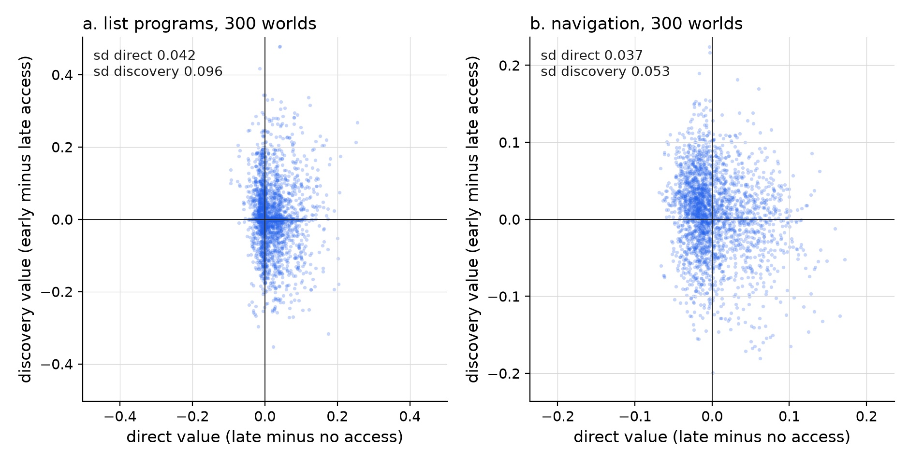

## Abstract

A learned abstraction can change what a program-searching learner discovers afterwards. We define its discovery value as the difference in a frozen learner's success on withheld tasks between learning with the abstraction available and learning without it, with the abstraction supplied at the test in both cases. Adding an abstraction defined from existing primitives never changes what can be expressed, only what a bounded search reaches. We prove that discovery value is not determined by compression of past solutions, direct usefulness or the immediate effect on search, and that two abstractions can exchange their order by discovery value when checking candidates becomes more expensive, so no score that ignores the search budget orders abstractions correctly at every cost. In 300 random worlds in each of two domains, list programs and navigation between rooms, discovery value varied more across abstractions than direct value did (standard deviations 0.096 and 0.042 in the share of test tasks solved; 0.053 and 0.037), took both signs, was reliable across independent test families and had the opposite sign to direct value for more than half of the abstractions. Within worlds, compression of past solutions correlated with it at 0.11 and 0.08 and a look-ahead on the learner's own curriculum at 0.22 and 0.08, against reliability ceilings of 0.88 and 0.80. Rankings at verification costs eight times apart agreed at only 0.16 and 0.19 after correction for reliability. Fertility here belongs to an abstraction together with a budget and a future, and is mostly invisible when the abstraction is adopted.

## 1. Two abstractions with the same record

A learner that solves problems by searching over programs can name a recurring piece of its solutions and use the name as a single step afterwards. Suppose two such pieces appear equally often in its past solutions, so naming either shortens the record of its past work by the same amount, and suppose each, added to the learner's vocabulary, lets it solve the same number of new problems directly. The learner then keeps working: it searches for solutions to a curriculum of harder problems, names recurring pieces of the solutions it finds, and searches again. Whether the first abstraction was in its vocabulary during that work can change which problems it reaches, which pieces it names next and therefore what it can do at the end. Two abstractions with the same record can leave the learner with different futures.

This paper studies that difference. We call the effect of having an abstraction during later discovery its discovery value, and an abstraction with large positive discovery value fertile, after the older use of fertility for theories that keep generating new problems and results [@mcmullin1976; @kuhn1977]. The question is when learning an abstraction changes what a bounded learner discovers next, by how much, and whether the change can be predicted from what the learner knows when it adopts the abstraction. Every part of the general idea has been studied: abstractions that make later abstractions easier to find are the mechanism of library-learning program synthesizers [@ellis2021; @bowers2023], and a computational model with human experiments shows that the order in which concepts are acquired changes which later concepts people reach [@zhao2024]. What is missing is a way to separate the effect of an abstraction on later discovery from its effect as a tool, under equal computational budgets, and an account of what that separation implies for choosing abstractions.

We make four contributions. First, we define the discovery value of an abstraction through an early-, late- and no-access design. The abstraction is available at the final test in both compared conditions, so the contrast isolates its effect on what was learned. Second, we prove that discovery value is not determined by an abstraction's compression of past solutions, its direct usefulness or the immediate effect of adding it to the learner's search. Third, we prove that the ordering of two abstractions by discovery value can reverse when verifying candidate programs becomes more expensive, so that no score computed without reference to the search budget can order abstractions correctly at every cost. Fourth, we measure discovery value for 2,400 candidate abstractions in 300 randomly generated worlds in each of two domains, list-manipulating programs and navigation between rooms. In both, discovery value varies more across abstractions than direct value does, takes both signs, and is reliable across independent test problems; the compression of past solutions predicts it barely or not at all, direct value predicts it with the wrong sign, and the best predictor we tested, a costly look-ahead on the learner's own curriculum, recovers about a third of the attainable benefit in one domain and little in the other. Rankings of abstractions by discovery value change with verification cost far more than measurement noise allows.

The setting is program search with a growing library. The mechanism resembles what accounts of imagination describe when a mind constructs possibilities that change its own later construction of possibilities, but nothing here concerns imagery or experience, and the results are about the learners and worlds simulated.

## 2. Prior work

### 2.1 Macro-operators and the utility problem

Planning research learned early that stored solution fragments can speed later search. STRIPS generalized successful plans into macro-operators that could be reused as single steps [@fikes1972]. Korf showed that macro-operators learned for permutation puzzles such as the Eight Puzzle and Rubik's Cube allow solutions to be assembled without search, and treated macro-operator learning as a general weak method [@korf1985]. Iba selected macro-operators from solution traces with heuristics and filtered them by their usefulness [@iba1989], Soar's chunking summarized the results of subgoal processing into new rules [@laird1986], and Macro-FF extracted, ranked and filtered macro-operators from experience in a domain to speed later planning [@botea2005]. In reinforcement learning, options extend primitive actions with temporally extended ones [@sutton1999]. Whether options help depends on the problem: Jong, Hester and Stone found that standard ways of adding temporal abstraction help only in limited contexts and traced their benefit to the exploration they induce [@jong2008], and Solway and colleagues gave a Bayesian account of which hierarchies of subtasks are optimal for a set of tasks and found that people tend to discover such hierarchies [@solway2014].

The same literature identified the cost side. Minton quantified the utility problem: learned control knowledge slows a problem solver when the cost of matching and using it exceeds what it saves [@minton1990]. Tambe, Newell and Rosenbloom traced slowdowns in Soar to expensive chunks [@tambe1990], and Markovitch and Scott treated the decision of which acquired knowledge to keep as a family of selection mechanisms [@markovitch1993]. All of this concerns an abstraction's direct effect on the search that uses it, which in the terms below is its direct value together with its branching cost.

### 2.2 Library learning and self-improving search

Algorithmic probability weights programs by their length [@solomonoff1964], and Levin's universal search allocates search time to programs according to that weight [@levin1973]. The optimal ordered problem solver applies this to a sequence of problems and reuses code from earlier solutions when doing so pays [@schmidhuber2004]; PowerPlay searches for new problems together with modifications of the solver that solve them without losing earlier skills [@schmidhuber2013]. Baxter's model of inductive bias learning shows how a learner embedded in an environment of related tasks can learn a hypothesis space that serves new tasks from the same environment [@baxter2000]. Dyna-style agents improve a policy with experience simulated from a learned model [@sutton1990]; there too internally generated search improves behaviour, with a fixed vocabulary of actions.

Library learning in program synthesis makes the loop concrete. The exploration-compression algorithm alternated between searching for programs and compressing the solutions into reusable components [@dechter2013]. DreamCoder alternates between solving tasks, refactoring solutions into a growing library of abstractions and training a neural search policy, and its libraries deepen as later abstractions are built from earlier ones [@ellis2021; @ellis2023]. Stitch synthesizes abstractions by corpus-guided top-down search and evaluates library quality by compressivity [@bowers2023]; babble finds abstractions modulo an equational theory [@cao2023]. Cropper showed that forgetting learned programs can reduce the hypothesis space and the sample complexity of an inductive logic programming learner [@cropper2020], a direct instance of the branching cost. Berlot-Attwell and colleagues re-examined three in-context library-learning systems built on large language models and found that their gains often vanished or reversed when baselines received the same computational budget, and found no evidence that one system reused its learned lemmas [@berlot2026].

Recent work on self-improving agents separates the skills an agent uses from the procedure that improves them. MetaSkill-Evolve evolves both on two timescales [@wang2026]. Hindsight meta-experience distillation re-executes an incumbent and a revised improvement procedure from the same restored discovery state, so that the effect of a revision on the subsequent search can be observed under a shared condition [@feng2026]. That comparison and the early- and late-access contrast below share a logic: hold the starting state fixed and compare the discovery processes two choices induce.

### 2.3 Abstraction learning in people

Which primitives a learner starts with changes what it learns: Piantadosi, Tenenbaum and Goodman showed that different primitive sets in a compositional language of thought predict different learning curves for rule-based concepts [@piantadosi2016], and program-induction models learn new concepts by reusing parts of old ones [@lake2015]. Zhao, Lucas and Bramley modelled conceptual bootstrapping with a repertoire that caches and reuses elements of earlier insights; the model predicts different learned concepts when the same evidence arrives in different orders, and four experiments with 570 participants showed the predicted curriculum-order and garden-pathing effects [@zhao2024]. Hernandez Cano and colleagues argue that existing library-learning algorithms compress past tasks retrospectively, and report that people building geometric patterns choose abstractions in a way consistent with compressing future tasks under a non-stationary task-generating process [@hernandezcano2026]. Resource-rational analysis supplies the general frame in which such choices trade benefits against computational costs [@lieder2020].

### 2.4 Novelty, creativity and usable information

Boden distinguished combinational, exploratory and transformational creativity [@boden1998]. Wiggins formalized creative systems as search in a conceptual space governed by rules for traversal and evaluation [@wiggins2006], Ritchie examined whether transforming a conceptual space can be made precise [@ritchie2006], and Espírito Santo, Wiggins and Cardoso use formal learning theory to argue that novelty is in general neither necessary nor sufficient for transformational creativity [@espiritosanto2024]. Schmidhuber's theory of creativity rewards an agent for improvements in its own ability to predict or compress [@schmidhuber2010]. Tria and colleagues modelled correlated novelties, in which each novelty opens the space for further ones [@tria2014]. Xu and colleagues defined usable information relative to a computationally bounded observer; unlike Shannon information, it can be created by computation [@xu2020]. Our setting has the same structure: an abstraction defined from existing primitives adds nothing to what can be expressed, but changes what a bounded search can reach.

### 2.5 Fertility as a criterion for theories

Philosophers of science have long counted fruitfulness among the virtues of theories. Carnap required that an explication be fruitful, useful for formulating many universal statements [@carnap1950]; Kuhn listed fruitfulness with accuracy, consistency, scope and simplicity as shared criteria of theory choice [@kuhn1977]; Lakatos judged research programmes by whether they keep predicting novel facts [@lakatos1970]; and McMullin examined fertility, a theory's capacity to be developed fruitfully, and argued that it makes the theory as developed over time the proper unit of appraisal [@mcmullin1976]. These accounts concern scientific theories and human judgment. The discovery value defined here is a measurable counterpart for abstractions in a bounded learner, and the results below bear on one of their themes: whether fertility can be assessed when an idea is adopted or only after its consequences have been worked out.

## 3. Bounded search over a growing library

### 3.1 Expressibility and accessibility

Let $X$ be a finite set of states and $\Sigma = \{p_1, \dots, p_b\}$ a set of primitive transformations $p_i : X \to X$. A library $L \supseteq \Sigma$ is an ordered set of tokens, each defined by an expansion $\delta(t) \in \Sigma^{+}$, a nonempty sequence of primitives; a primitive is its own expansion, and $|t|_\Sigma$ is the length of the expansion. A program $\pi = t_1 \cdots t_m$ is a nonempty sequence of tokens, applied from left to right, and its behaviour is the composed map $f_\pi = t_m \circ \cdots \circ t_1$. The expressible set of $L$ is $H(L) = \{ f_\pi : \pi \in L^{+} \}$, and the description length $\ell_L(h)$ of a behaviour $h \in H(L)$ is the length of the shortest program with behaviour $h$. A task specifies which behaviours are acceptable: in the first domain of Section 5 exactly one behaviour on all of $X$, in the second any behaviour that takes a given start state to a given goal.

The search procedure enumerates programs in length-lexicographic order: all programs of length 1, then all of length 2, and so on, ordered within a length by the token order. Each candidate costs
$$\kappa(t) = c_v + c_x\,|t|_\Sigma,$$
where $t$ is its last token: $c_v$ is the cost of checking a candidate against the task and $c_x |t|_\Sigma$ the cost of executing the last token, with the result of the prefix cached. A task is solved within budget $B$ if the first program meeting its specification is reached at cumulative cost at most $B$. The first program found is a shortest one over the current library. We write $C_L(h)$ for the cumulative cost at which behaviour $h$ is first produced and $A_B(L) = \{h : C_L(h) \le B\}$ for the accessible set. With $n = |L|$ tokens and $c_x = 0$, the number of programs of length at most $d$ is
$$N_n(d) = \sum_{j=1}^{d} n^{j}.$$

**Proposition 1** (expressibility and accessibility). Let $a$ be a token with $\delta(a) \in \Sigma^{+}$, added last in the token order. (i) $H(L \cup \{a\}) = H(L)$. (ii) If $c_x = 0$, a behaviour with description length $\ell$ over $n$ tokens is first produced at a cost between $c_v (N_n(\ell - 1) + 1)$ and $c_v N_n(\ell)$. (iii) If no shortest program for $h$ over $L \cup \{a\}$ contains $a$ and $\ell_L(h) \ge 2$, then $C_{L \cup \{a\}}(h) > C_L(h)$, so $h$ leaves the accessible set for every budget in $[C_L(h), C_{L \cup \{a\}}(h))$. If instead adding $a$ shortens the description of $h$ from $\ell$ to $\ell' < \ell$ and $c_x = 0$, then $h$ enters the accessible set for every budget in $[c_v N_{n+1}(\ell'), c_v(N_n(\ell - 1) + 1))$ when that interval is nonempty.

*Proof.* (i) Replacing each occurrence of $a$ by its expansion turns a program over $L \cup \{a\}$ into a program over $L$ with the same behaviour, and $L \subseteq L \cup \{a\}$. (ii) All programs shorter than $\ell$ come first, at unit cost $c_v$ each. (iii) Let $\pi$ be the first program for $h$ over $L$, of length $m = \ell_L(h) \ge 2$. A shortest program for $h$ over $L \cup \{a\}$ does not contain $a$, so it is a program over $L$ and has length at least $m$; hence $\ell_{L \cup \{a\}}(h) = m$, and every program of length $m$ for $h$ over $L \cup \{a\}$ is a program over $L$. The lexicographic order of sequences over the old tokens is unchanged, so $\pi$ is still the first program for $h$, and every candidate examined before $\pi$ over $L$ is still examined before it. The one-token program $a$ is also examined before $\pi$, at positive cost. So $h$ is first produced by $\pi$ at a strictly greater cost. The second statement follows from (ii). $\square$

These facts are elementary, and the first is the reason Section 4 can treat discovery value as a matter of access: an abstraction defined from primitives never changes what can be expressed. The second part of (iii) is the toy calculation behind macro-operators, under which an abstraction helps when $\ell' \log(n+1) < \ell \log n$ roughly. The first part is its cost: every behaviour that needs at least two tokens and has no shortest program using the abstraction is reached later. Figure 1 shows both effects in the list domain of Section 5. Adding one four-primitive abstraction, the most compressive pattern in one world's history, barely changes the number of distinct behaviours a budget reaches, but at a budget of 13,082 units it makes 1,356 behaviours newly reachable and 1,295 unreachable, out of 3,011 reachable without it.

### 3.2 Discovery and the three values of an abstraction

A discovery process takes a library $L$ and a curriculum of discovery tasks. In each of three rounds it searches for every task with budget $B$, compresses the solutions found and adds the resulting abstractions to the library. Compression is greedy description-length reduction in the manner of Stitch [@bowers2023] and of minimum description length more generally [@rissanen1978]: a contiguous pattern of $k$ tokens occurring $c$ times without overlap in the solutions saves
$$g = c\,(k - 1) - k$$
tokens, the shortened occurrences minus the definition; the compressor adds the pattern with the largest saving among patterns of two or three tokens that occur at least twice, rewrites the solutions, and repeats once, skipping patterns whose behaviour is the identity or duplicates a token. New abstractions may contain earlier ones, so libraries deepen.

For a candidate abstraction $a$, let $K_1$ be the abstractions discovered from $L \cup \{a\}$ and $K_0$ those discovered from $L$, and let $U(M)$ be the share of withheld test tasks that a frozen search with library $M$ solves within an evaluation budget. Learned tokens are placed in a fixed order at evaluation, by primitive length and then expansion, so that identical learned sets give identical libraries. Table 1 sets out the three conditions.

| condition | $a$ during discovery | $a$ at evaluation | library evaluated |
|---|---|---|---|
| no access | no | no | $L \cup K_0$ |
| late access | no | yes | $L \cup \{a\} \cup K_0$ |
| early access | yes | yes | $L \cup \{a\} \cup K_1$ |

: Table 1. The early-, late- and no-access design. Each discovery run gives every task the same budget, so the compared conditions use the same search allowance.

The direct value, discovery value and total value of $a$ are
$$V_{\mathrm{direct}}(a) = U(L \cup \{a\} \cup K_0) - U(L \cup K_0), \qquad V_{\mathrm{disc}}(a) = U(L \cup \{a\} \cup K_1) - U(L \cup \{a\} \cup K_0),$$
and $V_{\mathrm{total}}(a) = V_{\mathrm{direct}}(a) + V_{\mathrm{disc}}(a)$. Both terms of $V_{\mathrm{disc}}$ contain $a$, so a difference cannot come from one evaluator holding the original tool and the other not. Both conditions also pay the same cost to acquire $a$, so the contrast compares timing; a claim that adopting $a$ is worth its acquisition cost requires a further comparison with no access. Discovery value is relative to the learner, the discovery and evaluation budgets, the curriculum and the distribution of later tasks; it is not a property of the abstraction alone.

Because evaluation depends only on the learned set, $V_{\mathrm{disc}}(a) \neq 0$ requires $K_1 \neq K_0$. Early access can change the learned set in two ways: the learner can build descendants, abstractions that contain $a$, or it can learn different abstractions that do not contain $a$ because $a$ changed which tasks it solved and how it wrote their solutions.

## 4. What compression and direct use cannot determine

The two constructions in this section use a free domain over $\Sigma = \{0, 1, 2, 3\}$ in which a program's output is the concatenation of its tokens' expansions, so two programs are equivalent exactly when their expansions are equal; this is a transformation domain in which each token appends its expansion to a string. Candidates cost one unit each ($c_v = 1$, $c_x = 0$), budgets count candidates, and the discovery process is the one of Section 3.2. Both constructions are checked by exact enumeration in the accompanying code.

### 4.1 A separation

**Proposition 2.** There are a history, a curriculum of two task families, a set of test tasks, a budget and two abstractions $a$ and $a'$ of the same length such that $a$ and $a'$ have the same compression saving and frequency in the history, the same direct value, the same number of discovery tasks newly solved in the first round and the same frontier compression (defined in Section 4.3), while $V_{\mathrm{disc}}(a) = 1/3$ and $V_{\mathrm{disc}}(a') = 0$.

*Construction and proof.* Let $\sigma(x) = 3 - x$, applied symbolwise, and let $a = 012$ and $a' = \sigma(a) = 321$. The history is $\{0123, 3210, 012321, 321012\}$, which $\sigma$ maps onto itself; each of $a$ and $a'$ occurs three times without overlap, so each has frequency 3 and saving $3 \cdot 2 - 3 = 3$. The curriculum has the family $F = \{aay : y \in \Sigma\}$ and its image $\sigma(F)$. The test tasks are $G = \{yaa : y \in \Sigma\}$, its image $\sigma(G)$ and $S = \{aaaay : y \in \Sigma\}$, twelve in all, and $B = 500$ for discovery and evaluation. With the four primitives alone, every discovery and test task has description length at least 7, and $N_4(6) = 5{,}460 > 500$, so nothing is solved: $K_0 = \emptyset$ and the no-access score is 0.

With $a$ added as the fifth token, the task $aay$ is the program $(a, a, y)$, reached at cost $N_5(2) + 25 \cdot 4 + 5 \cdot 4 + y + 1 = 151 + y$, with the symbols read as token indices. The four solutions contain the pattern $(a, a)$ four times, with saving $4 \cdot 1 - 2 = 2$, and no other pattern twice, so $K_1 = \{aa\}$; the next round finds nothing to compress. At evaluation with late access, $yaa$ costs $N_5(2) + 25y + 24 + 1 = 55 + 25y \le 130$, while $aaaay$ needs five tokens and is first reachable after $N_5(4) = 780$ candidates, so $V_{\mathrm{direct}}(a) = 4/12$. With early access the library has six tokens; $aaaay$ is the program $(aa, aa, y)$ at cost $N_6(2) + 5 \cdot 36 + 5 \cdot 6 + y + 1 = 253 + y \le 256$, so the four tasks of $S$ are added and $V_{\mathrm{disc}}(a) = 4/12$. The map $\sigma$ carries every statement about $a$ to one about $a'$ except the last: $\sigma(S)$ is not among the test tasks, so the descendant $a'a'$ only shortens the tasks of $\sigma(G)$, which late access already solves, and $V_{\mathrm{disc}}(a') = 0$. In both cases the first round newly solves four tasks of a single family, so frontier compression, which counts only patterns recurring across families, is 0 for both. $\square$

The difference between $a$ and $a'$ lies entirely in the later tasks: those tasks reuse two copies of $a$ and never two copies of $a'$. Nothing measured on the history, on the abstraction's direct use or on the first round of discovery can register that difference, because the history, the direct uses and the first round are exchanged by $\sigma$. A predictor of discovery value has to bet on how later demands resemble the curriculum.

### 4.2 A reversal with verification cost

**Proposition 3.** There are a history, a curriculum, test tasks, an evaluation budget and two abstractions $a$ and $b$ such that $V_{\mathrm{disc}}(a) > V_{\mathrm{disc}}(b)$ when the discovery budget is 1,000 candidates and $V_{\mathrm{disc}}(a) < V_{\mathrm{disc}}(b)$ when it is 200.

*Construction and proof.* Let $a = 012$ and $b = 3210$, with history, curriculum and test tasks
$$\{a3b,\ b1a,\ ab\} = \{01233210,\ 32101012,\ 0123210\},$$
$$\{yaaz : (y, z) \in \{(0,1), (1,2), (2,3), (3,0)\}\} \cup \{bby : y \in \Sigma\},$$
$$\{aaaay : y \in \Sigma\} \cup \{bbbby : y \in \{0, 1\}\},$$
and an evaluation budget of 300. In the history $a$ and $b$ each occur three times without overlap, so their compression savings are $3 \cdot 2 - 3 = 3$ and $3 \cdot 3 - 4 = 5$. Without either abstraction every discovery task has at least eight symbols and nothing is solved. With $a$, the task $yaaz$ is a four-token program, reached after at most $N_5(4) = 780$ candidates; at a discovery budget of 1,000 all four are solved and $K_1 = \{aa\}$, as in Proposition 2. At a budget of 200 none is solved, since the first of them, $0aa1$, comes at $N_5(3) + 122 = 277$, and $K_1 = \emptyset$. With $b$, the task $bby$ is a three-token program reached at $151 + y \le 154$, so at either budget $K_1 = \{bb\}$. At evaluation, late access solves no test task for either abstraction, since a five-token program needs more than 780 candidates; early access solves the four tasks $aaaay$ with $aa$ and the two tasks $bbbby$ with $bb$, each as a three-token program at cost at most 256. So at a discovery budget of 1,000, $V_{\mathrm{disc}}(a) = 4/6 > V_{\mathrm{disc}}(b) = 2/6$, and at 200, $V_{\mathrm{disc}}(a) = 0 < 2/6$. $\square$

A budget of 200 candidates in place of 1,000 is what a fivefold increase in the cost of checking a candidate does to a fixed amount of compute. The fertility of $a$ depends on discovery programs of four tokens and that of $b$ on programs of three, and the deeper one is lost first.

**Corollary.** A score assigned to each abstraction without reference to the discovery budget orders $a$ and $b$ the same way at both budgets, so it misorders them at one of the two. In this construction the compression savings are 3 for $a$ and 5 for $b$, which places $b$ first and is wrong at the higher budget.

Retrospective compression, reuse frequency and the length of an abstraction are all scores of this kind. The corollary does not say that such scores carry no information about discovery value; it says that any relation between them and discovery value must change with the budget, and Section 5.5 measures how much it changes.

### 4.3 Estimating discovery value from the learner's own data

Proposition 2 shows that discovery value depends on later demands that the learner has not seen. A learner can still estimate it if the families in its curriculum resemble later families, for example if both are drawn from the same process. Discovery value also acts only through the learned set, which changes only through the discovery tasks that $a$ brings within reach or pushes out of reach and through the way their solutions are written. These two observations suggest a ladder of predictors, ordered by what they use and how much they cost:

- history compression, the saving $g$ of $a$ in the history from which candidates are drawn, and history frequency, its number of occurrences there;
- direct value, measured on half of the test families and compared with discovery value on the other half, so that no test task enters both; it uses information a learner would not have and serves as a reference;
- frontier yield, the change in the number of discovery tasks solved in the first round when $a$ is added, and frontier gain, the number of discovery tasks solved in the first round with $a$ and not without it;
- frontier compression, the saving that the learner's compressor finds in the first-round solutions with $a$, counting only patterns that recur in at least two task families, minus the same quantity without $a$;
- look-ahead, the design of Table 1 applied to the learner's own curriculum: discovery on half of the families with and without $a$, evaluation on the other half, averaged over both directions.

The frontier statistics cost one round of search with $a$. The look-ahead costs two discovery runs and four evaluations per candidate, which is comparable to measuring discovery value itself, but uses no test task.

## 5. Experiments in two domains

### 5.1 Domains and protocol

The first domain consists of transformations of lists of length 5 over $\{0, 1, 2\}$, so $X$ has 243 states. The six primitives rotate the list left by one (rot), reverse it (rev), swap the first two elements (swp), add one modulo 3 to the first element (inc), copy the first element into the second position (cpy), and replace the first element by the sum of the first two modulo 3 (add). Each world draws five level-1 concepts, sequences of two to four primitives with no shorter primitive description and distinct behaviours, and four level-2 concepts, sequences of two or three units of which each is a level-1 concept with probability 0.75 and a primitive otherwise, with at least two concepts. A task family is a template of two or three slots, each a level-2 concept with probability 0.45, a level-1 concept with probability 0.25 or a free slot; every template has at least one fixed and one free slot, and its tasks fill the free slots with random primitives. A task asks for the exact behaviour on all 243 lists. The learner's history is 30 programs, each a sequence of two or three level-1 concepts, each followed by a random primitive with probability 0.4.

The second domain is navigation in a building of $4 \times 4$ rooms, each of $3 \times 3$ cells, joined by single-cell doors placed along a random spanning tree of the room grid plus each remaining adjacency with probability 0.35; a world has about 160 cells. The primitives move one cell north, east, south or west and leave the agent in place at a wall. A family is an ordered pair of rooms at most two rooms apart, and its tasks ask for a plan taking a start cell in the first room to a goal cell in the second, at least four moves away; only the start cell is checked, so many programs solve a task. The history is the shortest plan for each of 30 random trips of three to six moves. The two domains differ in their primitives, in whether a task fixes a whole behaviour or one outcome, and in where their regularities come from: a generative grammar of concepts in one, the geometry of a building in the other.

In both domains a world has 24 discovery families and 60 disjoint test families of four tasks each, 96 discovery and 240 test tasks. The candidates are the eight patterns of two to four primitives in the history with the largest compression saving, keeping one per behaviour and excluding the identity and single primitives. The base library is the primitives. Every search has a budget of 15,000 units, with execution cost $c_x = 1$ per primitive; evaluation uses verification cost $c_v = 1$, and discovery is run at $c_v \in \{1, 2, 4, 8\}$. Discovery has three rounds of two abstractions each. We generated 300 worlds per domain, which gives 2,400 candidates per domain and cost. Agreement between a predictor and discovery value is the Spearman correlation across the eight candidates of a world, averaged over worlds, with 95% intervals from 4,000 bootstrap resamples of worlds. Reliability is the same correlation between discovery values measured on two halves of the test families. The design, parameters and predictor definitions were settled on pilot worlds drawn from other seeds; the curriculum was enlarged from 12 to 24 families during piloting because the smaller one gave noisier outcomes, and Section 5.4 reports the smaller one as a check. The reported run uses fresh worlds.

At verification cost 1, the base learner solves on average 29.3 of the 96 discovery tasks in the first round and 41.7 in its last round in the list domain, and 23.7 and 31.2 in navigation. Its final library solves 40.9% of the test tasks in the list domain and 27.7% in navigation.

### 5.2 Discovery value is large, two-signed and reliable

Figure 2 plots discovery value against direct value for every candidate at verification cost 1. In the list domain the standard deviation of discovery value across candidates is 0.096, against 0.042 for direct value: early access changes the share of test tasks solved by more than five percentage points for 47.8% of candidates, in either direction, with 46.2% of candidates positive and 41.8% negative. Discovery value exceeds direct value in magnitude for 65.6% of candidates, and the two have opposite signs for 55.8% of those for which both are nonzero. In navigation the corresponding standard deviations are 0.053 and 0.037; 32.0% of candidates change the test score by more than five points through discovery, and the signs are opposite for 58.3%.

These differences are not noise in the test set. The split-half reliability of discovery value across candidates within a world is 0.64 (95% interval 0.60 to 0.68) in the list domain and 0.47 (0.44 to 0.51) in navigation, or 0.78 and 0.64 for the full test set by the Spearman–Brown formula. The reliable differences also survive matching on the quantities a learner usually sees. Among 505 pairs of candidates in the same list world whose compression savings differ by at most 1 and whose direct values, measured on the first half of the test families, differ by at most one task, the difference in discovery value measured on one quarter of the test families correlates at 0.57 with the difference measured on another quarter, and 40.6% of these pairs differ by more than five points; in navigation, 912 such pairs give 0.30 and 38.4%. Proposition 2 constructs such a pair by hand; the random worlds contain many.

Direct value and discovery value are negatively related. Measured on disjoint halves of the test families, their within-world correlation is $-0.12$ (95% interval $-0.16$ to $-0.07$) in the list domain and $-0.23$ ($-0.26$ to $-0.20$) in navigation. In individual worlds we inspected, one mechanism is visible. When an abstraction is enough by itself to bring a group of test tasks within reach, late access already collects that gain and early access has little to add, whereas a fragment of the same structure may solve nothing directly and still let the learner build the larger abstraction during discovery. The total effect of having the abstraction early is split between the two channels in proportions that vary from abstraction to abstraction.

### 5.3 How early access changes what is learned

Early access almost always changes the learned library: the learned set is identical with and without the candidate for 5.3% of candidates in the list domain and 1.4% in navigation, and in all those cases discovery value is exactly zero, as Section 3.2 requires. For 74.7% of list candidates and 78.5% of navigation candidates the learner builds at least one descendant, an abstraction containing the candidate. The remaining 21.3% and 20.2% change the learned set without any descendant: the candidate changes which discovery tasks are solved and how their solutions are written, and the compressor then selects different abstractions. These redirections carry 19.7% and 19.1% of the total absolute discovery value. In the list domain their mean effect is negative, $-0.024$, against 0.016 for candidates with descendants, and the number of descendants correlates with discovery value at 0.15 (0.10 to 0.21) within worlds; in navigation the correlation is indistinguishable from zero ($-0.05$ to 0.05). Figure 4b shows the two distributions.

Being one of the world's level-1 concepts helps a candidate only slightly. True concepts make up 47.3% of the candidates and have mean discovery value 0.011, against 0.003 for fragments and cross-boundary patterns, and mean direct value 0.028 against 0.012. A ground-truth score that credits a candidate for supplying part of a concept the base learner never learned, weighted by how many test families use that concept, does not predict discovery value: its within-world correlation is $-0.03$ ($-0.08$ to 0.03).

### 5.4 How well discovery value can be predicted

Figure 3 gives the agreement of each predictor with discovery value. In the list domain at verification cost 1, history compression correlates with discovery value at 0.11 (0.06 to 0.15) and history frequency at 0.01; direct value, measured on the other half of the test families, at $-0.12$; frontier yield at 0.17 (0.12 to 0.22), frontier gain at 0.13 and frontier compression at 0.06; and the look-ahead at 0.22 (0.17 to 0.26). A predictor that measured each candidate's discovery value without error would be expected to correlate at about 0.88 with the measured values, given their reliability. In navigation, history compression correlates at 0.08 (0.04 to 0.12), frontier yield at 0.07, frontier gain at 0.03, frontier compression at $-0.04$ and the look-ahead at 0.08 (0.03 to 0.12), against a ceiling of about 0.80; direct value correlates at $-0.23$.

In practical terms, choosing the candidate a predictor ranks first raises discovery value above the world's average candidate by 0.036 with the look-ahead, 0.022 with frontier yield and 0.013 with history compression in the list domain, against 0.114 for choosing the best candidate in hindsight; the look-ahead thus captures about a third of the attainable gain. In navigation the look-ahead and history compression each gain 0.006 against an attainable 0.066, and choosing by direct value loses 0.016.

The ordering of predictors is stable when the curriculum is halved to 12 families in the list domain: history compression correlates at 0.10, frontier yield at 0.21, frontier gain at 0.19 and the look-ahead at 0.21, and direct value at $-0.13$.

### 5.5 Verification cost

Proposition 3 implies that rankings by discovery value can change with the cost of verification. Figure 4a measures how much. The agreement between rankings at verification cost 1 and at a higher cost, measured on disjoint halves of the test families and divided by the geometric mean of the two within-cost reliabilities, falls from 0.56 at cost 2 to 0.36 at cost 4 and 0.16 at cost 8 in the list domain, and from 0.58 to 0.32 and 0.19 in navigation. Rankings of the same candidates in the same worlds are thus close to unrelated when checking a candidate costs eight times as much, although the within-cost reliability stays between 0.57 and 0.64 in the list domain and between 0.46 and 0.48 in navigation.

History compression does not depend on the verification cost, so its agreement with discovery value must move as the rankings move: in the list domain it is 0.11 at cost 1 and $-0.02$ ($-0.06$ to 0.03) at cost 4. A predictor that depends on the budget can follow the change only if it is computed at the right cost. The look-ahead does so in the list domain: computed at cost 1 and cost 4 and compared with discovery value at the same cost, it correlates at 0.23; compared with discovery value at the other cost, at 0.15, a difference of 0.08 (0.05 to 0.11). The frontier statistics show no such advantage in the list domain, and in navigation only frontier yield shows a small one, 0.02 (0.00 to 0.04).

## 6. Limits and interpretation

The learner is deliberately simple. Its search enumerates programs without the observational-equivalence pruning used by practical enumerative synthesizers [@udupa2013; @albarghouthi2013; @gulwani2017], without a learned search policy of the kind DreamCoder trains [@ellis2021], and with a greedy compressor that adds two abstractions per round. Each of these choices affects which abstractions are learned and therefore discovery value. The worlds were generated by us, with regularities of two particular kinds, and the candidates were the most compressive patterns of a short history; a learner that proposes candidates differently faces a different set of comparisons. Nothing here measures an effect in people or in deployed systems.

Within those limits, the results separate two claims that are easy to run together. The first, that learned abstractions make later discovery easier, holds only weakly on average: mean discovery value is 0.007 in both domains. The second, that some abstractions are more fertile than others, is strongly supported: the differences between candidates are large, reliable across test families and present among candidates matched on compression and direct use. What the results do not support is that fertility can be read from the record an abstraction has when it is adopted. Compression of past solutions, the quantity library learners commonly optimize [@bowers2023; @cao2023], carries little information about discovery value in these worlds and none detectable in the list domain at verification cost 4, and direct usefulness points the wrong way. Prospective selection, which targets future tasks [@hernandezcano2026], needs a model of those tasks, and Proposition 2 shows why: discovery value depends on demands beyond the learner's experience.

Several results would change this picture. A cheap predictor that tracked discovery value closely in either domain, a learner with equivalence pruning or a learned search policy for which compression did predict it, or worlds in which discovery value was small next to direct value would each narrow the claim. The look-ahead's partial success in the list domain and its failure in navigation also leave open what makes fertility estimable: in the list domain test families share concepts with the curriculum, while in navigation each pair of rooms poses its own route, and estimation from the curriculum depends on such sharing.

The philosophical accounts of fertility in Section 2.5 treat it as something judged over time, as a theory or research programme is developed. In these learners discovery value is a property of a trajectory: of the abstraction together with the learner's budget, curriculum and later demands. Among the eight most compressive patterns of each history, the abstractions a compression-based learner would adopt first, early access lowered the later score for 41.8% in the list domain and 38.2% in navigation. A learner that cares about what it will discover next has to spend computation looking ahead at its own curriculum, and the value it estimates holds only for the budget at which it looked.

The simulation code and a record of the run that produced every number and figure are in the repository; `simulation/run_all.py` reproduces them and runs 13 checks, including exact enumeration of the two constructions.

## References
